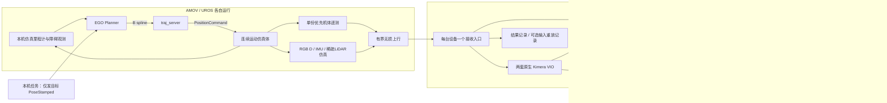

# 双机仿真架构与数据流

当前部署采用两台仿真控制端和一台集中建图端。AMOV 是 robot 0，UROS 是 robot 1；两机各自运行 EGO-Swarm、连续运动仿真体、障碍观测、传感器和无损上行。本机运行两份 VIO、局部 TSDF/mesh frontend、LCD/DPGO/PGMO，以及显示、按profile录制和后处理。两机只保留日志及进程管理信息，不启动原始录包或地图保存节点。

这保留两个逻辑机器人的 Kimera-Multi 消息与算法接口，但所有 SLAM 计算集中在本机；不再把此部署描述为两台设备分担分布式优化计算。

## 规划与 SLAM 的边界

任务脚本只在 `/two_pc/drone_N/goal` 发布目标 `PoseStamped`。EGO Planner 独占本机局部 B-spline 输出，`traj_server` 独占 `PositionCommand` 输出，连续仿真体以积分跟踪指令，不复制目标位置。路径选择、避障、重规划和队友轨迹避碰都由各设备上的 EGO-Swarm 完成。调整两条任务目标序列不会授权脚本生成飞行轨迹或替代 EGO 控制。

规划当前使用仿真里程计和障碍观测，Kimera 输出尚未接回规划闭环。仿真真值只供运动控制、场景渲染和离线评估；不得将其接入 VIO、回环或稠密地图估计来代替估计结果。设备从各自本地相同scene生成原有5米/10 Hz规划障碍云，不依赖本机先推送场景云。场景先验只用于仿真与EGO规划，不代替Kimera建图。独立LiDAR当前不被RGB-D VIO或TSDF输入桥消费，可稀疏上传；深度图和IMU仍是估计链必需输入。

## 单次上行与本机分发

设备传感器名为 `/sim_N_edge_sensors`，八路传感器输出重映射到 `/edge/sim_N/...`，只供该设备的 `/sim_N_sensor_uplink` 订阅。RGB、浮点深度、有效掩码和两份CameraInfo按原始相同时间戳配对并无损压缩。renderer不再重复发布机体真值；uplink独立直接订阅 `/drone_N_visual_slam/odom`，以源时间戳相位抽样为默认30 Hz实际机体遥测。

五条通道仍为truth（实际遥测）、imu、rgbd、lidar和ready，协议版本2按通道绑定真实发布者。truth queue=1、请求4 KiB socket发送缓冲；RGB-D/LiDAR请求64 KiB、queue=1。IMU保持独立有序队列。实际遥测与IMU设置DSCP EF，RGB-D保持默认服务类，LiDAR标记CS1背景类；这只是可验证的socket标记，不保证无线AP按优先级调度。

本机 `/sim_N_multimodal_sensors` 是五条上行通道唯一远端订阅者，校验robot/run/cutoff、调用者、完整性、长度、序号和年龄后原样分发。任务、轨迹和场景显示统一从本机 `/sim_N/ground_truth/odometry` 获取实际机体状态；EGO自己的本地100 Hz里程计、规划与控制topic保持原样，不再为每个本机消费者各开一条跨LAN里程计连接。

RGB-D/IMU和所选LiDAR测点保留原始ROS字节，包括Header.seq/stamp/frame、深度浮点位及协方差。遥测源抽样、LiDAR抽帧/抽点显式计数和记录配置；不能将这种有意省略当作IP丢包。LiDAR物理16×180射线模型保持，默认上传1 Hz、每4个实测hit选1点，本地EGO障碍云不稀疏。

图像缓存和解压大小有上限，过期/不完整/重复/错误来源显式省略并计数，不修改时间戳、不补造图像、不向SLAM发布实际机体真值。默认图像源龄上限2秒，IMU仍共享物理无线介质，性能需实测。设备只保留日志和进程元数据。

## 视觉与协同轨迹

`native_vio_graph_adapter.py` 保留原生关键帧 ID、时间戳及体坐标里程计关系，将所需的相机位姿和图接口送入协同后端。LCD 利用视觉描述信息发现候选，经过几何验证后形成跨机器人约束，DPGO 优化轨迹。

并非每条新消息都代表一次完成优化。桥接层观察请求、权重更新、终止命令、最终权重与轨迹变化；这些观测用于限制旧结果与新结果混用。原生消息缺少共享原子轮次标识，目前该绑定仍有工程局限。

## 局部稠密地图

RGB-D 点使用原时间戳和标定回投；局部位姿来自原生 VIO。旋转插值采用实测 IMU 角速度曲线并约束到原生 VIO 两端姿态，平移按原生 VIO 端点插值。超过里程计或 IMU 间隔限制时显式省略样本，不使用仿真真值补齐。

两套 Voxblox 均在集中本机运行，分别在 `sim_N/vio_odom` 中积分，mesh frontend 生成原生几何和网格图。局部显示话题 `/sim_N/native_dense/raw_local_vertices` 直接显示该逻辑机器人的原生 frontend 网格顶点，颜色仅区分来源。默认目标积分输入 5 Hz、网格生成周期 1 秒，实际进度仍以原生完成日志验证。

TSDF 的网格定时器会重复发布现有地图。验证持续建图要查看实际积分完成记录、输入消息年龄和队列，不能只统计 mesh 话题频率。

## 全局轨迹与网格修正

本项目固定使用现代 Kimera-PGMO MESH API。完成的协同相机轨迹转回体坐标后，由原生 PGMO 处理轨迹先验与网格变形；桥接层不以 ICP、自定义点云配准或真值拟合生成全局地图。

为验证轨迹确实改变了历史网格，桥接层保留同一个原生 mesh 输入，获取稳定基线、提交轨迹、等待原生数值回执，再触发该固定 mesh，检查历史顶点的实际变化。事务期间暂停向 PGMO 转发新的图和网格，局部传感器输入按设计继续运行。

传感器回投与后端事务位于独立进程。本次集中部署改造没有改变原有观测轮次协议，也不把部署或单元检查通过当作新一轮持续建图验收。

## 全局展示和版本规则

`native_dense_global_view.py` 只消费两机 `accepted_joint_mesh` 及对应状态，检查运行轮次、mesh 哈希、优化 owner、请求窗口和最终权重内容。只有一致的两份原生结果才发布 `/visualization/native_mesh/global_cloud`。

展示层按顺序拼接两份已通过校验的原生顶点，分别染为青色和橙色；不再配准、重投影或混入旧轮次地图。当前最新版本不一致时清空全局显示，等待匹配结果。空窗口可能表示版本校验未通过，不等于两机未收到任何局部地图。

## 数据保留边界

| 数据 | 在线用途 | 默认长期保存 |
|---|---|---|
| RGB、深度、IMU及CameraInfo | 原生VIO与TSDF必需 | map模式消费后释放；replay/debug模式录制 |
| 机体实际状态、VIO估计、入口状态 | 任务/显示/诊断 | map模式保存紧凑遥测，不重复整条Path |
| 独立LiDAR | 当前Kimera链无依赖 | 稀疏辅助上传；仅debug录制 |
| RGB-D回投云、TSDF更新、mesh frontend、PGMO过程输出 | 必要在线中间接口 | 不重复录包，在线消费者照常运行 |
| DPGO命令、全部共享图、权重与显示Marker/Path | 协同计算或显示 | debug才录；最终有效pair保留必要证据 |
| 最终已接受native pair/两份原生mesh/回执/标定 | 全局地图与来源证据 | 导出并保留 |

全局显示云只拼接XYZ并按机器人染色，不能单独替代带三角面和原始颜色的最终网格。`export_final_global_map.py`按可选截止时间选择有效pair，校验native hashes、顶点/三角形和回执，导出全局PLY/PCD、合并原生三角网格及两份原始证据，不重优化地图或改变native拓扑。稀疏显示是派生视图，不能改native PGMO内部顶点顺序。

## 通信与运行边界

默认 RViz 绘制上限 30 FPS、机体位置显示 20 Hz；完整路径以 2 Hz 重建，状态与文件以 1 Hz 更新，避免高频反复序列化整条历史路径。显示帧率、传感器频率、TSDF 积分与网格周期可分别配置。

专用容器使用本机 NVIDIA 显卡执行 OpenGL 显示，显式软件模式仍可作为排查选项。原生 VIO、Voxblox、DPGO 和 PGMO 保留现有 CPU 实现，GPU 接入不等于这些算法已经改写为 CUDA。GPU/驱动与实际渲染器校验见 `dependencies/locks/hub_gpu_runtime.json`。

集中建图要求原始传感器流实时上行，网络吞吐、消息年龄、序号间隙和 IMU 覆盖需要在真实运行中单独验收。共享master与任务节点仍是实验依赖，尚未证明网络分区或节点失联时整个系统的容错能力。

当前未实现语义标签推理，也未验证真实飞控、扫描去畸变、硬件时间同步或多机外参标定。
