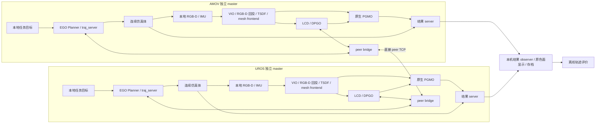

# 双机仿真架构与数据流

当前分布式 profile 由 AMOV、UROS 各运行完整本地原生 Kimera 链，并使用直接 peer 通信。本机是独立结果 observer。当前入口为 `experiment/three_host_20261102/distributed/manager.py`；集中 baseline 保留，见文末。

第五轮 `distributed_continuity_20261104_153318` 已完成两圈运动、共享地图连续性修复核验、原生结果导出与三主机关闭。功能改造完成，AMOV 强实时性能未通过；完整运动 accepted mesh 最大更新间隔仍为 22.8619 秒。下述架构与证据边界继续适用。

## 三个独立 ROS 图

| 主机 | 身份 | 本机 master | 主要工作 |
| --- | --- | --- | --- |
| AMOV | robot 0 | `http://192.168.5.6:11431` | 本地 EGO、仿真、VIO/TSDF/LCD/DPGO/PGMO、peer、结果 server |
| UROS | robot 1 | `http://192.168.5.21:11431` | 同上；EGO 与原生 Kimera 在各自 ROS1 容器中共享该机 master |
| 本机 | observer | `http://192.168.5.14:11431` | 接收、显示、存档与离线评价 |

图中是数据依赖，不是由本机调度 SLAM。原始图像、IMU、局部里程计与地图计算留在各设备；本机退出不会等同于 AMOV/UROS 的 peer 失联。第二轮旧 combined observer 飞行中退出时阶段由 18 推进到 20；第四轮 map-only 退出在运动完成后，阶段保持 20，两端 TSDF 完成数仍增加 42/43。后者只验证该时段地图接收退出不阻断局部积分，不能替代飞行中故障注入。

## 规划、actual 与估计边界

每机任务状态机只在 `/two_pc/drone_N/goal` 发布 `PoseStamped`，并通过 peer 交换阶段状态。EGO Planner 产生本地 B-spline，`traj_server` 唯一产生 `PositionCommand`，连续仿真体通过积分跟踪指令。目标脚本不合成控制轨迹，不复制目标位置。两机未来 B-spline 通过 peer 的 EGO 通道交换，不能只桥接 Kimera 消息而丢失 EGO-Swarm 互避输入。

规划使用仿真机体里程计及本机生成的场景障碍观测，尚未验证 Kimera 输出驱动导航。已知场景只用于仿真和规划，不充当重建地图。actual 机体状态允许用于仿真控制、任务保护、显示和离线评价；VIO、回环、分布式优化及 TSDF 均不得用 actual 替代估计。

原始传感器在本机 ROS 图中直接喂给原生 VIO/局部回投。RGB-D 使用原时间戳与标定；旋转插值使用 IMU 角速度和原生 VIO 端点，平移使用原生 VIO 端点，覆盖不足时显式省略，不用 actual 补齐。

## 原生本地链路与版本

每机运行 VIO、`native_vio_graph_adapter`、独立 local sensor bridge、Voxblox TSDF、mesh frontend、LCD、DPGO 和现代 PGMO MESH 接口。adapter 保留原始关键帧 ID/时间戳，处理相机/机体坐标约定。局部 TSDF 在 `sim_N/vio_odom` 中连续积分；backend 事务、网络发送与局部回投位于独立进程。

当前 `execution_mode=online` 将完成的协同相机轨迹转换回机体约定，提交给原生 PGMO，继续接收新局部图和 mesh。native Path/pose_graph 用于检查原生 keys、时间戳、有限位姿与路径使用情况；PGMO 是软优化，位姿残差单独报告，不把它称为逐 pose 精确数值 ACK 或地图精度保证。

历史固定 mesh 诊断模式用于证明同输入下历史顶点变化，需要归档事务证据；它不是当前无持久化在线模式的默认执行方式。重复 mesh 定时发布不证明新 TSDF 积分，积分完成日志、源龄和队列需要独立监测。

依赖采用固定提交及本地兼容补丁，不是官方 v1.0.0 依赖组合。ARM64/x86-64 必须分别编译，OpenCV/GTSAM/Eigen ABI 与所有跨机消息 MD5 需一致；OpenGV 防护库也按架构独立核验。

## 直接 peer 协议

`peer_bridge.py` 是项目自有 TCP 替代通信层，参考上游 RTM 的消息清单，未使用或冒称原作者 RTM。control、feature、ego 三条独立全双工通道由 robot 0 直接连接 robot 1，hub 不中转。

白名单包含 BoW、BoW/VLC 请求与响应、loop closure/ACK、pose corrector、DPGO lifting matrix、status、command、anchor、public poses/measurements、weights，以及 EGO B-spline、机体/任务状态。原始图像和 IMU不经 peer 广播。VIO 的 `vlc_frame_query` 与 LCD 的 `request_pose_graph` service 留在本地同一 master 内；只转发少量结果 topic 不能替代整个请求/响应协议。

握手核验 run/cutoff、双方 robot/boot、消息 schema/MD5，接收桥是明确的本地 proxy caller。原生来源、序号和 hash 保留在 metadata 中，不把 proxy caller 冒充成原生节点。原始 ROS 字节与来源 metadata 使用本机原子伴随消息关联，避免两个独立 ROS 话题在负载下错配或有限回执缓存逐出。

控制/特征流使用有界 RAM outbox、ACK/重发和去重；EGO 流只保留新鲜状态。传输 ACK 表示本地 proxy 发布返回，并非原生优化器已经处理。接收会话驱动 `connected_peer_ids`，不能用任意 Header 或 hub 心跳代替双向会话健康。当前恢复范围是同进程内 TCP 重连；peer boot 改变、可靠队列溢出或关键数据过期要求新 run，不能承诺无盘状态下进程重启续图。

## 结果传输与本机显示

每端结果 server 在 11740/TCP 提供 map 流、11741/TCP 提供独立 actual/VIO 遥测。本机主动订阅；边端回调只替换固定 stream 的有界 latest，压缩、socket 等待及本机磁盘速度不占用原生 SLAM 锁。

本机使用两个独立进程：map 的 `/distributed_result_observer` 只处理 mesh/图/路径、Marker、PLY 与地图状态；telemetry 的 `/distributed_telemetry_observer` 只接收和发布 actual/VIO、归档紧凑遥测，不构造 mesh/Marker/PLY，也不覆盖 map status。第二轮旧 combined 模式的独立 socket/线程仍竞争同一 Python GIL；第三、四轮改用两个进程，分别由 manager role 归属与关闭，不自动派生无人管理的子进程。进程隔离改善遥测不表示消除了原生网格处理积压。

map 流包含完整原生 local mesh、最新 native PGMO mesh、accepted mesh、status、DPGO path、实际提交的 body path、已核验的 `verified_body_path` 及 optimized graph。传输保留 XYZ、原始 RGBA、三角面、时间戳、graph indices 和其余 ROS 元数据，不修改顶点顺序。

首包/重连发送 compressed 全量；可选 delta 按完整 ROS 字节块差分，携带 base/result hash，能覆盖历史顶点、拓扑、截断和扩展。缺 base 或 hash 不符时请求全量，不能将新点追加等同于完整增量地图。run、boot、gauge 配置、source topic/caller、type/MD5、原始长度及解压大小均校验。

本机 `observer.py` 只反序列化、发布和存档，不估计、ICP 配准、焊接顶点或拟合地图。原生 mesh 使用 `TRIANGLE_LIST` 显示完整面与原色。默认仅渲染 local 与通过证据的 shared faces；相同 snapshot/action/boot/gauge 不重复序列化巨大 shared Marker，状态与 freshness 仍为 1 Hz。native/accepted 相同内容复用一次解码、完整几何校验与有界 geometry，未改变源顶点/面顺序。可用 observer 的 `--all-mesh-faces` 恢复其他镜像 faces。

生产默认仅存完整 `.rosbin`/metadata，不逐 snapshot 生成 PLY；显式 `--snapshot-ply` 用于需要逐份导出的诊断。最终从原始 ROS 结果离线导出仍可保留双精度 XYZ、完整三角面与原始 RGBA 数值，`.rosbin` 是全部原生元数据的权威副本。

局部视图固定在各自 `sim_N/vio_odom`；实际机体视图使用 `world`，不能未经估计关系强叠。共享视图仅在两端真实跨机优化证据及匹配 mesh receipt 就绪时发布。同名 frame、相同 `gauge-id` 都只是配置身份，不是初始化证明。observer 的 snapshot ID 是应用身份，不是共享原子优化轮次；本机不会因两个本地 serial 不同而宣称原子一致。

`shared_body_path` 必须与所选 mesh receipt 的 `submitted_body_path_sha256` 匹配，只忽略 ROS 修改的顶层 Header.seq。native dense 在 `/sim_N/native_dense/verified_body_path` 以 latch 发布最后已核验的原生 `nav_msgs/Path`，caller 仍为 `/sim_N/native_dense_bridge`；新 `approved_body_path` 待核验时不能覆盖它。observer 优先匹配独立 verified stream，并保留当前 run/boot/gauge 下最多 32 个 path 版本、128 MiB 的内容 hash 缓存。新进程重连可收到 latched verified path；缺 hash、换 boot 或错误 gauge 均不发布为共享路径。旧档案没有 verified stream 时，导出器仍从原 `body_path` 档案按同一 receipt hash 选择，不能仅凭目录最新版本放松关联。

observer 仍运行而结果链路断连时，last-known mesh 保留并明确标 stale，不伪造新时间戳。观察进程本身退出时不再生成状态，冻结的窗口标签不能当作实时健康证据。map status 的 telemetry 字段注明由独立进程处理、`status_available_here=false`，不表示遥测连接断开。

第四轮后的 continuity 修复区分最新提交与最后已核验路径。同一有效 native PGMO/gauge 会话已建立共享证据后，新的共享 path 待核验不再让已有 gauge 自动变回 local；receipt 明确记录 `newer_path_pending`、`latest_submitted_body_path_sha256`、`last_verified_body_path_sha256` 与 `native_path_echo_covers_latest_submission`。它不保证最新 path 已被使用，也没有证明当前 mesh 对应精确 optimizer generation。run/cutoff、key 0、frame、双方 peer boot、PGMO 进程身份与图 key 前缀继续核验；新 path 仍须有双方 active、真实跨机约束与完成证明。身份改变、图前缀回退或本地-only 新解不能沿用旧共享证明。第五轮不可变档案连续性审计全部检查通过；运动后以全新 RAM 缓存重启 map observer，复核 shared map 与两端 verified path 关联成功，未连续测恢复时延。

## 保存与质量评价

| 位置 | 允许保留 | 当前禁止 |
| --- | --- | --- |
| AMOV / UROS 磁盘 | 代码、标定/参数副本、进程归属、文本事件/状态/资源及任务日志 | raw bag、VIO 轨迹 CSV、图/mesh 二进制、PLY/TSDF/地图导出 |
| AMOV / UROS RAM | 当前图像/IMU缓存、关键帧和描述子、轨迹/图、TSDF/mesh、可靠重发队列 | 无法承诺零状态；进程重启后这些历史不具备磁盘恢复来源 |
| 本机 | 原生结果 ROS 字节、receipt、原色 faces、紧凑姿态、资源与离线指标 | 将 actual 或评价拟合送回估计、以独立配准结果冒充分布式融合 |

`quality_collector.py` 仅保存本机 actual、VIO 和通过 receipt 关联的 body path 姿态。`quality.py` 对两机联合 body path 共用一次 SE(3) 刚体对齐，计算 ATE、RPE 及覆盖；不估尺度，不逐机器人对齐联合结果。VIO 可单独以各自局部 gauge 做清楚标注的单机基线。缺机器人、缺配对和覆盖不足需明确报告，质量指标不自动等于验收通过。

## 保留的集中 baseline

`manager_hub.py` / `manager_local.py` 保留此前集中版本：设备仅控制/生成传感器，上行给本机运行两份完整 SLAM。它使用一个共享 master、传感器 ingress、旧 native-pair 全局显示/导出规则，与当前三个 master 的分布式 profile 不能混用。

2026 年 11 月 3 日集中运动、11 月 2 日旧双机故障和第四轮 continuity 修复前结果分别保留历史证据。第五轮以两端相同 0.20 m 原生 TSDF（默认 0.15 m）完成两圈 20/20、496.58 秒运动，真实 TSDF 完成 775/805 次。首次共享接纳后的 accepted mesh 更新间隔中位数为 AMOV/UROS 3.7527/1.9996 秒，P95 为 13.5174/2.9459 秒，最大为 22.8619/4.9907 秒；native mesh Header 是原生 `vertex_stamps.back()`，不能把它的年龄当相机到显示时延。AMOV 平均 CPU 90.75%，不能据功能通过宣称强实时。

该轮联合输出保留 109,117 个原生顶点槽、67,033 个面引用顶点与 146,846 个原色面。离线几何评价复用 body path 的一次团队 SE(3)，不另做 ICP、缩放或每机独立配准；它使用有限可见真值采样与顶点距离近似，不修改原生地图，也不充当共享原子优化证据。见[完整运行报告](/home/mrjq311/swarm_kimera_runtime/experiment/three_host_20261102/distributed/runs/distributed_continuity_20261104_153318/hub/final_report.json)、[分布式核验摘要](evidence/distributed_acceptance_20261104.json)、[已知问题](known_issues.md)与[分布式部署](distributed_deployment.md)。
