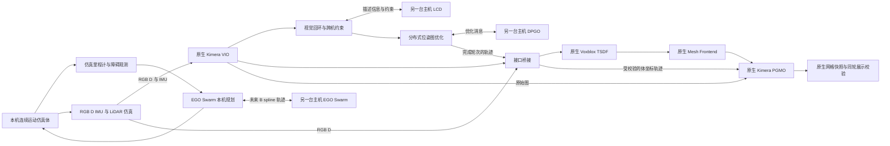

# 双机仿真架构与数据流

每台主机运行本机无人机的规划、传感器、视觉惯性定位、协同轨迹和稠密建图节点。当前 AMOV 是 robot 0，UROS 是 robot 1；共享 ROS1 master 负责名称发现，算法消息通过 ROS 网络连接传输。

## 规划与 SLAM 的边界

规划当前使用仿真里程计和障碍观测，Kimera 输出尚未接回规划闭环。仿真真值只供运动控制、场景渲染和离线评估；不得将其接入 VIO、回环或稠密地图估计来代替估计结果。LiDAR 当前用于录制和后续研究，当前 Kimera 回环依赖视觉输入。

## 视觉与协同轨迹

`native_vio_graph_adapter.py` 保留原生关键帧 ID、时间戳及体坐标里程计关系，将所需的相机位姿和图接口送入协同后端。LCD 利用视觉描述信息发现候选，经过几何验证后形成跨机器人约束，DPGO 优化轨迹。

并非每条新消息都代表一次完成优化。桥接层观察请求、权重更新、终止命令、最终权重与轨迹变化；这些观测用于限制旧结果与新结果混用。原生消息缺少共享原子轮次标识，目前该绑定仍有工程局限。

## 局部稠密地图

RGB-D 点使用原时间戳和标定回投；局部位姿来自原生 VIO。旋转插值采用实测 IMU 角速度曲线并约束到原生 VIO 两端姿态，平移按原生 VIO 端点插值。超过里程计或 IMU 间隔限制时显式省略样本，不使用仿真真值补齐。

Voxblox 在 `sim_N/vio_odom` 中积分，mesh frontend 生成原生几何和网格图。局部显示话题 `/sim_N/native_dense/raw_local_vertices` 直接显示本机原生 frontend 网格顶点，使用本机局部坐标系，颜色仅区分来源。

TSDF 的网格定时器会重复发布现有地图。验证持续建图要查看实际积分完成记录、输入消息年龄和队列，不能只统计 mesh 话题频率。

## 全局轨迹与网格修正

本项目固定使用现代 Kimera-PGMO MESH API。完成的协同相机轨迹转回体坐标后，由原生 PGMO 处理轨迹先验与网格变形；桥接层不以 ICP、自定义点云配准或真值拟合生成全局地图。

为验证轨迹确实改变了历史网格，桥接层保留同一个原生 mesh 输入，获取稳定基线、提交轨迹、等待原生数值回执，再触发该固定 mesh，检查历史顶点的实际变化。事务期间暂停向 PGMO 转发新的图和网格，局部传感器输入按设计继续运行。

这只是逻辑上的并行。当前桥接进程仍有共享锁、消息序列化和回调调度问题，持续局部积分尚未通过验收。

## 全局展示和版本规则

`native_dense_global_view.py` 只消费两机 `accepted_joint_mesh` 及对应状态，检查运行轮次、mesh 哈希、优化 owner、请求窗口和最终权重内容。只有一致的两份原生结果才发布 `/visualization/native_mesh/global_cloud`。

展示层按顺序拼接两份已通过校验的原生顶点，分别染为青色和橙色；不再配准、重投影或混入旧轮次地图。当前最新版本不一致时清空全局显示，等待匹配结果。空窗口可能表示版本校验未通过，不等于两机未收到任何局部地图。

## 通信与运行边界

协同计算不要求持续互传所有原始传感器数据，但 RViz、录制和调试订阅可能额外跨机传送网格与点云，应分别统计。共享 master、场景发布与任务节点仍是实验依赖，尚未证明网络分区或节点失联时整个系统的容错能力。

当前未实现语义标签推理，也未验证真实飞控、扫描去畸变、硬件时间同步或多机外参标定。
